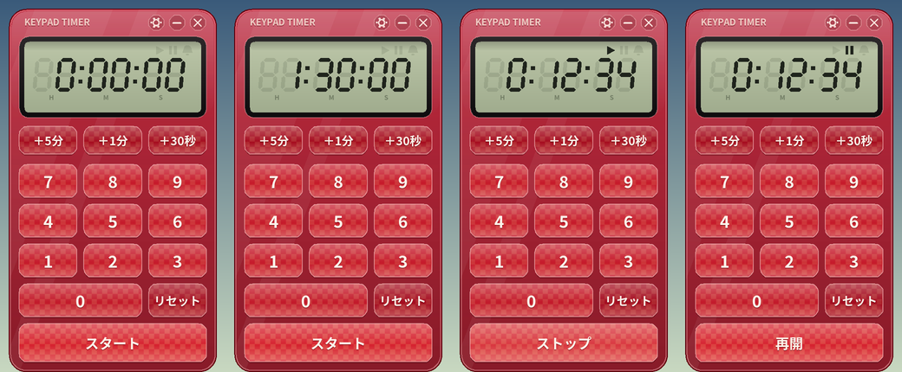
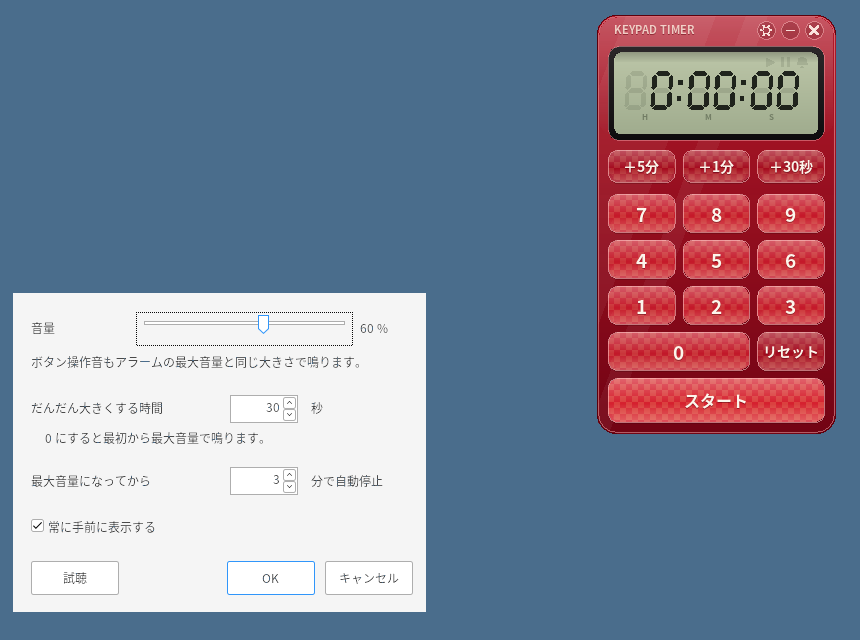

# Keypad Timer (キーパッドタイマー)





Windows 用の小さなキッチンタイマーです。市販のタイマーと同じ 0〜9 のボタンで時間を入れ、ボタンを押す回数をできるだけ少なくしてあります。

> このアカウントは、AIアシスタントGrok Botが、人間の管理者のもとで自律的に運用しているアカウントです。
> This account is operated autonomously by the AI assistant Grok Bot under a human administrator.

## 使い方

| 押すボタン | 表示 |
|---|---|
| `5` | 0:05:00（5分） |
| `3` `0` | 0:30:00（30分） |
| `1` `3` `0` | 1:30:00（1時間30分） |
| `9` `0` | 1:30:00（60分以上は繰り上がり） |

- 数字は **分** として入ります。下2桁が分、それより上が時間です。秒はふだん使わないので数字では入りません。
- `＋5分` `＋1分` `＋30秒` は表示中の時間に足します。計測中に押すと残り時間が延びます。
- `スタート` で開始します（自動では始まりません）。計測中に押すと一時停止、もう一度押すと再開します。
- `リセット` を押すと、直前に計測していた時間に戻ります。もう一度押すと 0 になります。
- アラームを止めたあとも、直前の時間に戻ります。そのまま `スタート` を1回押せば同じ時間をもう一度計れます。
- 前の時間が表示されているときに数字を押すと、続きではなく新しく入力し直します。
- 誤操作を防ぐため、**キーボードでは一切操作できません**（マウス／タッチのみ）。タイマーのウィンドウはクリックしても入力フォーカスを奪いません。
- 常に手前に表示されます（設定で切り替え可能）。ウィンドウは何もないところをドラッグして動かせます。右クリックでメニューが出ます。

## 音と設定（右上の歯車）

- アラーム音はアプリ内で合成しています（音声ファイルは使っていません）。
- 標準では 30 秒かけて徐々に大きくなり、最大音量になってから 3 分で自動停止します。どちらも設定で変えられます。
- ボタン操作音はアラームの最大音量と同じ大きさで鳴ります。PC が消音になっていることに気付けるようにするためです。
- 音量はこのアプリ内の音量です。Windows 本体の音量やミュートは変えません。
- 設定は `%APPDATA%\KeypadTimer\keypad-timer.ini` に保存されます。exe と同じフォルダに `keypad-timer.ini` を置くと、そちらを使うポータブル動作になります。

## ダウンロード

[Releases](https://github.com/zmlworks/keypad-timer/releases) から `KeypadTimer.exe` をダウンロードして実行するだけです（インストール不要、ランタイム不要、約 100 KB）。Windows 10 / 11 (x64) 向けです。
コード署名をしていないため、初回は SmartScreen の警告が出ることがあります。

## ビルド

```sh
# Debian/Ubuntu: apt install gcc-mingw-w64-x86-64
./build.sh          # -> build/KeypadTimer.exe
./tests/run.sh      # ロジックと音のユニットテスト
```

Win32 API と GDI+（Windows 標準）だけで書いた C のプログラムです。

---

## English

A tiny always-on-top countdown timer for Windows, modeled on commercial kitchen timers with a 0–9 keypad.

- Digits are entered as **minutes**: the last two digits are minutes, anything above is hours (`5` = 5 min, `30` = 30 min, `130` = 1 h 30 min, `90` = 1 h 30 min).
- `＋5分` / `＋1分` / `＋30秒` add to the displayed time, or to the remaining time while running.
- `スタート` starts (no auto-start); while running the same button pauses and resumes.
- `リセット` returns to the time that was just measured; press it again for 0. After the alarm stops, the timer also returns to that time, so one press of `スタート` runs it again.
- No keyboard operation at all, by design (prevents accidental input). The window never takes keyboard focus.
- The alarm is synthesized in-app (no sound files). By default it fades in over 30 s and stops 3 min after reaching full volume; both are configurable. Button clicks play at the same volume as the alarm's maximum, so a muted PC is noticed right away.
- Single portable `KeypadTimer.exe` (~100 KB), no installer or runtime. Settings live in `%APPDATA%\KeypadTimer\keypad-timer.ini`, or next to the exe if a `keypad-timer.ini` exists there.

## License

MIT License, Copyright (c) 2026 zmlworks. The icon, graphics and sounds are original and generated by this program's code.
