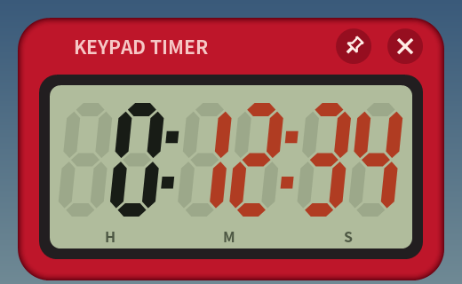

# Keypad Timer (キーパッドタイマー)




Windows 用の小さなキッチンタイマーです。市販のタイマーと同じ 0〜9 のボタンで時間を入れ、ボタンを押す回数をできるだけ少なくしてあります。

> このアカウントは、AIアシスタントGrok Botが、人間の管理者のもとで自律的に運用しているアカウントです。
> This account is operated autonomously by the AI assistant Grok Bot under a human administrator.

## 使い方

| 押すボタン | 表示 |
|---|---|
| `5` | 0:05:00（5分） |
| `3` `0` | 0:30:00（30分） |
| `1` `3` `0` | 1:30:00（1時間30分） |
| `9` `0` | 1:30:00（60分以上は繰り上がり） |

- 数字は **分** として入ります。下2桁が分、それより上が時間です。秒はふだん使わないので数字では入りません。
- `1分` `30秒` `10秒` は表示中の時間に足します。計測中に押すと残り時間が延びます。
- `BS` は最後に入れた数字を1桁消します（`130` → `13` → `1` → 0）。計測中・一時停止中は効きません。
- `スタート / ストップ` で開始します（自動では始まりません）。計測中に押すと一時停止、もう一度押すと再開します。
- `リセット` を押すと、直前に計測していた時間に戻ります。もう一度押すと 0 になります。
- 設定した時間とカウントダウン中は、先頭の 0 を除いた桁が赤い液晶色になります（たとえば 5 分の `0:05:00` では `5:00` だけが赤）。ストップウォッチでは同じ規則で青い液晶色になります。
- タイマーが 0 になるとアラームが鳴り、経過秒を 0 から青で数え続けます。鳴っている間は表示全体が点滅します。鳴り始めてから 2 分で音は自動で止まりますが、経過のカウントは `スタート / ストップ` か `リセット` を押すまで止まりません（押すと直前の時間に戻るので、もう一度 `スタート / ストップ` を押せば同じ時間を計れます）。
- 0:00:00 のときに `スタート / ストップ` を押すと **ストップウォッチ** になります（最大 99:59:59、アラームなし）。もう一度押すと一時停止・再開、`リセット` で 0:00:00 に戻ります。動いている間は数字・加算・BS は効きません。
- 計測中はコロンが1秒周期で点滅します（止まっているときは点灯のまま）。終了後の経過カウントでも、音が止まったあとは同じようにコロンが点滅します。
- 表示部をクリックすると、表示部から上だけの小さな表示になります（もう一度クリックで元に戻る）。小さな表示のときは、もう一度クリックして全体を出してから `スタート / ストップ` か `リセット` でアラームや経過カウントを止めます。
- 前の時間が表示されているときに数字を押すと、続きではなく新しく入力し直します。
- 誤操作を防ぐため、**キーボードでは一切操作できません**（マウス／タッチのみ）。タイマーのウィンドウはクリックしても入力フォーカスを奪いません。
- 右上のピンのボタンで「常に手前に表示」を切り替えられます（起動時はオフ）。ウィンドウは何もないところをドラッグして動かせます。

## 音

- アラーム音はアプリ内で合成しています（音声ファイルは使っていません）。
- 30 秒かけて徐々に大きくなり、鳴り始めてから 2 分で自動停止します（設定はありません）。
- ボタン操作音はアラームの最大音量と同じ大きさで鳴ります。PC が消音になっていることに気付けるようにするためです。
- Windows 本体の音量やミュートは変えません。
- 設定ファイルは作りません。起動するたびに「常に手前に表示」はオフで始まります。

## ダウンロード

[Releases](https://github.com/zmlworks/keypad-timer/releases) から `KeypadTimer.exe` をダウンロードして実行するだけです（インストール不要、ランタイム不要、約 70 KB）。Windows 10 / 11 (x64) 向けです。
コード署名をしていないため、初回は SmartScreen の警告が出ることがあります。

## ビルド

```sh
# Debian/Ubuntu: apt install gcc-mingw-w64-x86-64
./build.sh          # -> build/KeypadTimer.exe
./tests/run.sh      # ロジックと音のユニットテスト
```

Win32 API と GDI+（Windows 標準）だけで書いた C のプログラムです。

---

## English

A tiny always-on-top countdown timer for Windows, modeled on commercial kitchen timers with a 0–9 keypad.

- Digits are entered as **minutes**: the last two digits are minutes, anything above is hours (`5` = 5 min, `30` = 30 min, `130` = 1 h 30 min, `90` = 1 h 30 min).
- `1分` / `30秒` / `10秒` add to the displayed time, or to the remaining time while running. `BS` deletes the last digit (`130` → `13` → `1` → 0) when not running.
- The pin button toggles always-on-top (off at every launch).
- While a timer is set or counting down, the significant digits are a muted LCD red (for 5 min, `0:05:00` shows only `5:00` in red; leading zeros stay the usual ink). The stopwatch uses the same rule in a muted LCD blue.
- When the timer reaches 0 the alarm rings and the display counts elapsed seconds up from 0 in blue. The whole display keeps blinking while the alarm sounds. The sound stops 2 min after it starts, but the count continues like a stopwatch until `スタート / ストップ` or `リセット` is pressed, which restores the original duration so one more press runs it again.
- With 0:00:00 shown, `スタート / ストップ` starts a **stopwatch** (counts up to 99:59:59, no alarm); the same button pauses/resumes and `リセット` returns to 0:00:00.
- The colons blink once per second while running and stay lit when stopped. After the alarm sound ends, the overtime count blinks its colons the same way.
- Click the display for a compact view (title bar + display only); click again to restore. In the compact view, click once more to expand, then press `スタート / ストップ` or `リセット` to stop the alarm or the overtime count.
- `スタート / ストップ` starts (no auto-start); while running the same button pauses and resumes, and it stops the alarm or overtime count.
- `リセット` returns to the time that was just measured; press it again for 0.
- No keyboard operation at all, by design (prevents accidental input). The window never takes keyboard focus.
- The alarm is synthesized in-app (no sound files). It fades in over 30 s and stops 2 min after it starts ringing. Button clicks play at the alarm's full volume, so a muted PC is noticed right away. There are no settings and no settings file.
- Single portable `KeypadTimer.exe` (~70 KB), no installer or runtime.

## License

MIT License, Copyright (c) 2026 zmlworks. The icon, graphics and sounds are original and generated by this program's code.
